# Emergency Response Simulator

A 2D Nairobi-inspired emergency-response **training simulation** written in C++.

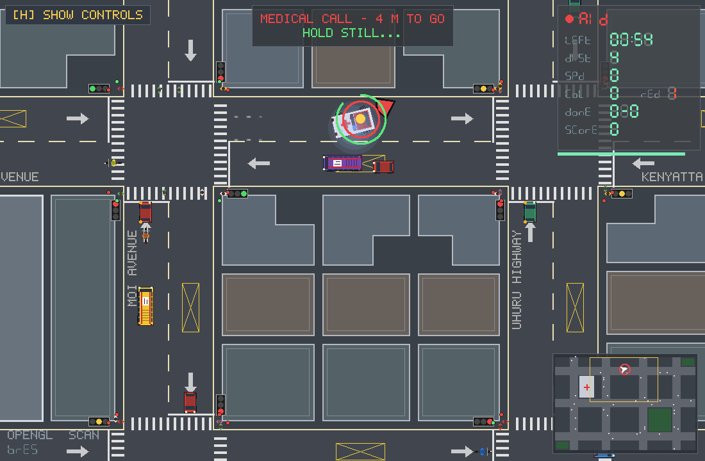

## Description

The trainee drives an ambulance through a fictional Nairobi-inspired district to reach emergency incidents. The district has live civilian traffic (cars, matatus and motorcycles), signalised intersections, pedestrians and buildings. The simulation is aimed at **ambulance drivers, paramedics and emergency-dispatch trainees**. It focuses on decision-making rather than physical driving skill:

- choosing efficient routes through a congested road network
- handling intersections and traffic signals under time pressure
- balancing response speed against safety

Each call ends with a result (response time, collisions, red lights run and wrong turns), so trainees can review how they performed. A call is only complete once the crew has treated the patient on scene and, for most calls, the patient has been handed over at the hospital.

**Secondary audience:** emergency-services training instructors.

> This is an educational training simulation. It is not a real dispatch or navigation system, and it does not teach physical vehicle control.

## Group Members

| Student No. | Name |
|---|---|
| 170048 | Eyoel Abraham |
| 146510 | Wanjiru Nicole |
| 167016 | Macharia Alysa |
| 167997 | Muteti Scott |
| 159056 | Marsa Fatma |

## Technologies and Tools

- **C++17**: all graphics algorithms are implemented by hand
- **OpenGL (legacy, fixed function)**: the default renderer. `glOrtho` projection, `glLoadMatrixf` for the camera and model matrices, `glBegin`/`glEnd` immediate mode for the pixels and scan-line spans our algorithms produce, alpha blending for the night tint and glows, and a **display list** (`glNewList`/`glCallList`) that records the static city once and replays it every frame.
- **SFML 2.5 / 2.6** (not 3.x): opens the window and its OpenGL context, reads the keyboard, and backs the software renderer. No SFML shape classes are used and SFML computes no geometry.
- **Resizable window**: everything is laid out on a fixed 1100 × 720 logical screen that both renderers letterbox into the window (`scale = min(W/1100, H/720)`, centred, black bars; `src/core/Letterbox.h`). Mouse clicks are mapped back with the inverse; losing focus pauses the drive and nothing is drawn while the window is minimised. The simulation runs at a fixed 60 Hz step with a 0.25 s cap on catch-up after a stall.
- **CMake 3.16+** and **CTest**: build system and unit tests

## Graphics Techniques Implemented

| Area | Algorithm(s) | Source | Used in the project for |
|---|---|---|---|
| Line drawing | DDA, Bresenham (toggle with **L**) | `src/lines/` | Road markings, outlines, wheel tread, debug vectors |
| Polygon fill | Scan-line fill (half-open edge rule), spans submitted in one batch | `src/rasterization/PolygonFill.cpp` | Roads, blocks, buildings, vehicles, HUD segments, night overlay |
| Polygon triangulation | Ear clipping: a vertex is an ear when it is convex (`cross(b − a, c − b)` has the sign of the shoelace area) and no other vertex lies inside the triangle; n − 2 triangles for any simple polygon | `src/polygons/Triangulation.*` | **F** cycles the fill: our scan-line fill → ear-clipped triangles filled by our scan-line (edges shown) → the same triangles sent to OpenGL as `GL_TRIANGLES`; L-shaped (concave) buildings |
| Line clipping | Cohen–Sutherland | `src/rasterization/Clipping.cpp`, `LineRenderer` | Every segment is cut to the camera view before rasterisation; **C** shrinks the clip window so it is visible |
| Point and span clipping | A pixel square is kept when it overlaps the clip window (four comparisons); text spans outside the window's rows are dropped and the rest cut to its left/right edges | `src/core/Raster.h` | Signal bulbs, pedestrians, trees, glows and painted text are cut to the camera view too, so the **C** demo frame clips everything |
| Polygon clipping | Sutherland–Hodgman | `src/rasterization/Clipping.cpp`, `PolygonFill` | Polygons crossing the view edge are clipped before the scan-line fill, polygons outside are skipped (viewport culling); headlight cones |
| Camera | View matrix `T(window/2) · T(−centre)`, exponential smoothing `c += (d − c)(1 − e^(−k·dt))`, look-ahead, clamping, crash shake | `src/core/Camera2D.*` | Follows the ambulance through a world bigger than the window; loaded with `glLoadMatrixf` in OpenGL |
| Road graph | Graph built from the road list: nodes = junctions + map-edge points, edges = road sections weighted by length; nearest point on a segment by projection `t = clamp(((p − a)·(b − a)) / |b − a|², 0, 1)` | `src/city/RoadGraph.*` | Incident spots (middle of every section, both lanes), pathfinding and the minimap; a new map only changes the road list |
| Window-to-viewport | `M = T(viewport centre) · S(s, s) · T(−window centre)`, `s = min(vw/ww, vh/wh)` (uniform, keeps the aspect ratio), then everything clipped to the viewport | `src/ui/Minimap.*` | Minimap (**M**): blocks, roads, parks, hospital, traffic dots, route, pulsing target, the camera's view frame and a rotated ambulance arrow |
| Circles & ellipses | Midpoint circle, midpoint ellipse, row-filled solids | `src/shapes/` | Wheels, signal bulbs, pedestrians, incident marker, hold-still arc |
| Curves | Cubic Bézier, Catmull-Rom, arc-length parameterisation | `src/curves/` | Traffic routes; quarter-circle Bézier corners at every turn |
| **Transformations** | 3×3 homogeneous matrices; composite `T * R * S`; pivot `T(p) * M * T(-p)`; inverse | `src/core/Mat3.*` | All polygon transforms, vehicle placement |
| **Hierarchical modelling** | Scene graph: `world(child) = world(parent) * local(child)` | `src/simulation/SceneNode.*` | Ambulance: body → steering nodes → wheels, light bar, rotating beacon |
| Animation | Wheel spin = distance / radius; projected tread; time-driven rotation; bicycle steering model | `src/simulation/Ambulance.*` | Driving, steering, siren lights, beacon |
| Effects | Skid marks: rear-wheel world positions from the scene graph (`T(p)·R(h)·mount`) laid as segments while the tyres slide (handbrake, hard braking, lateral acceleration `v²·tan(δ)/L` above the grip limit, hits), fading `alpha = 170·s·(1 − age/12 s)` in a fixed-size queue. Siren glow: six concentric midpoint-circle discs alpha-blended over each other, so coverage falls off with distance; per-disc alpha follows the day/night darkness | `src/simulation/SkidMarks.*`, `SirenGlow.*` | Tyre marks on the road, red/blue glow alternating with the light bar (off when the siren is muted with **E**) |
| Colour interpolation | Keyframed palette, linear interpolation, alpha compositing | `src/city/DayNight.*` | Day/night cycle (**T**) |
| Collision | Broad phase: AABB overlap. Narrow phase: **Separating Axis Theorem** on convex polygons (project both shapes on every edge normal; a gap on any axis = no hit, else the smallest overlap gives the contact normal and depth); concave buildings are split into their ear-clipped triangles. Response: impulse along the contact normal (restitution 0.3, friction 0.15) | `src/simulation/Collision.*`, `CollisionSystem.*`, `Ambulance::resolveCollision` | Rotated ambulance vs rotated vehicles and buildings: head-on hits bounce, glancing hits slide and turn the nose, sparks at the contact point; **G** shows broad-phase boxes, SAT-tested shapes and hits |
| Shortest path | Dijkstra and A* (heuristic = straight-line distance, admissible and consistent because every edge weight ≥ its length) with a binary heap, O((V + E) log V), on the road graph plus the two points where the ambulance and the target join the roads | `src/simulation/Pathfinding.*`, `RouteGuide.*` | A* plans the flowing route line and arrow every frame; HUD distance along the roads; **V** runs both on the same query and marks the settled nodes (Dijkstra rings, A* discs numbered in order) with the counts and costs |
| Text | Seven-segment hexagon glyphs; hand-made 5×7 bitmap font turned into scan-line runs | `src/ui/` | HUD read-outs; objective banner; controls panel (**H**) |

### Renderer architecture

```
 scene modules (city, vehicles, traffic, HUD) ── pure C++, no SFML / OpenGL headers
        │  pixels, scan-line spans, segments from OUR algorithms
        ▼
 IRenderer  (src/render/IRenderer.h)   view matrix + model transform stack
        ├── GLRenderer        legacy OpenGL: glOrtho, glLoadMatrixf, glBegin(GL_QUADS)
        └── SoftwareRenderer  Mat3 on the CPU, quads handed to SFML in one batch
```

Every scene module draws through `IRenderer`, so it never includes a graphics library header and the unit tests build without SFML or OpenGL. **O** switches renderer at run time; both produce the same image (the only differing pixels are the renderer label). **L** cycles Bresenham → DDA → *API*, where the last mode hands the end points to `GL_LINES` so our line algorithms can be compared with the graphics card's.

### How transformations are used

Every model is authored in local coordinates (front of the vehicle along +x) and placed with one composite matrix:

```
world = T(position) * R(heading) * S(size)      (applied right to left)
```

Combining the transforms into a single matrix means each vertex is transformed once, and the same matrices compose naturally into a hierarchy. In the ambulance the front wheels hang under a steering node, so `world(wheel) = T(pos) * R(heading) * T(mount) * R(steer)`; turning the steering node turns only the wheels below it.

With the OpenGL renderer the same hierarchy uses the graphics card's matrix stack: every scene-graph node calls `pushTransform(local)` (the `glPushMatrix` / `glMultMatrix` pattern, loaded with `glLoadMatrixf`), its shape is rasterised by our algorithms in its own local frame, and OpenGL transforms the result; `popTransform()` restores the parent. The software renderer instead multiplies the matrices on the CPU and rasterises in world space. `tests/test_render_paths.cpp` checks both paths put every vehicle in the same place.

### Traffic and intersections

- Signalised intersections on a road grid; every module derives its geometry from `RoadNetwork`, so the map is defined once. The district is 4 avenues × 3 streets (12 junctions) on a 2260 × 1500 map with uneven block sizes and Nairobi-inspired road names; city blocks, buildings, parks, trees and the hospital are generated from the grid. Road names are painted along every other road section (the 5×7 font's pixels moved with `T(centre)·R(−90°)·T(−size/2)` on north–south roads; a 90° rotation keeps them on the pixel grid) and a concave lane arrow is placed before every stop line with `T(lane)·R(direction)`.
- **Left-hand traffic** as in Kenya: the lane centre is the road centre plus `leftOf(direction) * 35`, where `leftOf(dx, dy) = (dy, -dx)` in screen coordinates.
- Each intersection runs a signal state machine: `NS green → NS yellow → all red → EW green → EW yellow → all red` (24 s cycle). The junction in grid column *c*, row *r* starts at `offset = ((c + r) · 8 s) mod 24 s`, so neighbours switch a third of a cycle apart (a simple green wave) and the grid never switches all at once.
- **Routes are generated from the grid**, not hand-written: a loop round every grid cell in both directions, a loop round the whole grid, every road end to end (U-turns just off the map) and zig-zags between neighbouring roads. Each waypoint list becomes straights, Bézier corners and U-turns via `RoadNetwork::buildRoute`, so a bigger map gets traffic automatically.
- Civilian vehicles use the stopping relation **v² = 2·b·d**: red means stop; yellow means stop only if `v²/2b` fits before the line; they follow leaders with `v = √(vL² + 2·b·gap)` and give way to pedestrians and the ambulance.
- **Yield rule in the junction box**: a vehicle about to enter a box waits while a conflicting vehicle is inside it (or committed just ahead of it). Conflicting means a different direction, except two vehicles going straight past each other in opposite lanes. Ties are broken by distance then index, so two vehicles can never wait for each other. A soak test (`tests/test_traffic_system.cpp`) runs 7 minutes of traffic and checks that no two vehicles ever overlap and nobody waits more than 40 s.
- Turns are cubic Bézier corners whose control points sit 0.5523·r towards the corner (quarter-circle approximation); left turns are tight and right turns wide purely from the lane offsets.
- **Density** (low / medium / high = 2.5 / 3.5 / 5 vehicles per intersection) for the difficulty levels; 60% cars, 25% matatus, 15% motorcycles. A matatu stage sits in the middle of every road section between two junctions.
- The ambulance is never forced to stop, but red lights it runs are counted.
- **Siren yielding** (on while responding, **E** mutes it): vehicles ahead of the ambulance in its direction within 320 px pull over towards the kerb (a lateral offset of up to 20 px added to their path position along `leftOf(direction)`, eased at 30 px/s) and crawl at 18 px/s; oncoming vehicles slow to half speed and keep left; crossing traffic holds before a junction the ambulance is approaching.
- **Congestion** (`src/simulation/Congestion.*`): every vehicle is assigned to the road section it is on; a queued vehicle (< 15 px/s) costs ~3 s, a moving one 0.3 s, so `factor = 1 + (queued·3 + moving·0.3)·90 / length`, capped at 4 and smoothed with `1 − e^(−dt/1.5 s)`. A* multiplies each edge length by its factor, so the route avoids queues; the **V** overlay colours every road section green → amber → red. Vehicles pulling over for the siren count as moving.
- No vehicle is spawned within 140 px of the ambulance's starting bay.

### Calls: the incident state machine

Every call runs through `src/simulation/Mission.*` (unit-tested in `tests/test_mission.cpp`):

```
EnRoute ──stopped at the scene──> OnScene ──treatment done──> Transport ──stopped in the hospital bay──> Completed
   │                                 │  (fire: no patient) ─────────────────────────────────────────────> Completed
   │                                 └─ drives off: treatment abandoned, back to EnRoute
   └─ leg time limit exceeded ──> Missed            (Transport can also run out of time)
Completed / Missed ──2.5 s──> next call
```

- **Five kinds of call** (`src/simulation/Incidents.h`), picked by inverse transform sampling on their weights:

  | Call | Share | Time to scene | On scene | Hospital | Base score |
  |---|---|---|---|---|---|
  | Medical | 30% | 60 s | 3 s | yes | 500 |
  | Road crash | 25% | 70 s | 4 s | yes | 450 |
  | Fire | 20% | 50 s | 2 s | no | 400 |
  | Cardiac arrest | 15% | 45 s | 5 s | yes | 600 |
  | Maternity | 10% | 75 s | 3 s | yes | 450 |

- **Stopping** means `distance < radius` and `|speed| < 15 px/s`, held for 1 s (radius 45 px at a scene, 90 px in the hospital bay so either lane counts).
- **On scene** the crew treats the patient (time per call type above); the timer pauses, a ring fills up round the marker and the ambulance must stay stopped.
- **Transport** (every call except fire): a second leg with its own timer, `limit = (|dx| + |dy|) / 45 px/s + 25 s` from the Manhattan distance to the hospital (the shortest possible road distance on a grid). The route, banner and HUD switch to the hospital.

- **Wrong turns** (`RouteGuide`): the planned route is kept while the ambulance follows it (the part already driven is cut off at the ambulance's projection onto the polyline). It is planned again, counted as a wrong turn and announced on the banner (*WRONG TURN – RECALCULATING ROUTE*) when the ambulance is more than 95 px from the route or has been moving against the route's direction for 2.5 s (driving the wrong way); the first 5 s of a leg are a grace period for turning round. It is also re-planned every 4 s without a penalty, so new congestion is taken into account.

### Scoring and screens

The game runs as a shift: **Title → Playing → Result after every call → … → Shift over** when a call is missed. Each call is scored (`src/simulation/Scoring.*`, unit-tested):

```
score     = max(0, base + timeBonus - collisions * 50 - redLights * 30 - wrongTurns * 20)
timeBonus = clamp(parTime - responseTime, 0, 30 s) * 10 points/s
parTime   = shortestRouteLength / 90 px/s + 5 s per stop   (route measured when each leg starts;
                                                            a call with a patient has two legs and two stops)
responseTime = driving time of both legs (time spent treating on scene is not counted)
base      = per call type (table above)
grade     = A: base + 100 or more, B: at least base, C: at least 70% of base, D: above 0, F: 0
```

**Difficulty** (title menu, A/D or ←/→ to change):

| | Traffic | Time limits | Score |
|---|---|---|---|
| Easy | low (2.5 vehicles per junction) | × 1.3 | × 0.8 |
| Normal | medium (3.5) | × 1.0 | × 1.0 |
| Hard | high (5) | × 0.8 | × 1.25 |

The grade compares the call score *before* the multiplier. **High scores**: the five best shifts (score, difficulty, calls) are kept in `highscores.txt` next to the game (`src/simulation/HighScores.*`); a shift is recorded when it ends (a missed call, or Esc to the menu), and the game-over panel announces a new entry. Damaged lines in the file are skipped.

Menus, pause, result and game-over panels are drawn with our scan-line fill and 5×7 pixel font (`src/ui/Screens.*`); the city keeps running behind the title menu.

### Debug views

- **G**: polygon vertices and scan lines, stop lines in their signal colour, each car's target-speed vector coloured by what limits it (white = yielding in a junction box), collision boxes, scene-graph axes, arrival radius, route turning points
- **B**: route splines, Bézier control polygons and control points
- **C**: shrinks the camera clip window to a yellow frame, so the Cohen–Sutherland and Sutherland–Hodgman culling that normally happens at the screen edge is visible
- **V**: Dijkstra vs A* on the current route: settled nodes, counts and costs
- **F**: polygon fill mode (scan-line, ear-clipped triangles, OpenGL triangles)

| Traffic debug (G) | Routes (B) | Night (T) |
|---|---|---|
| 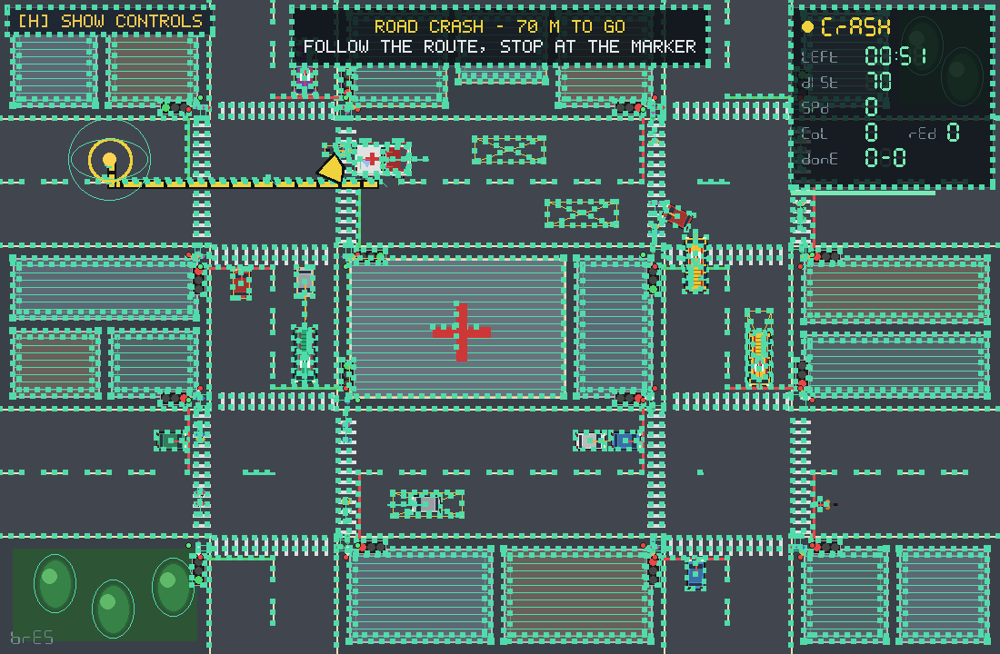 | 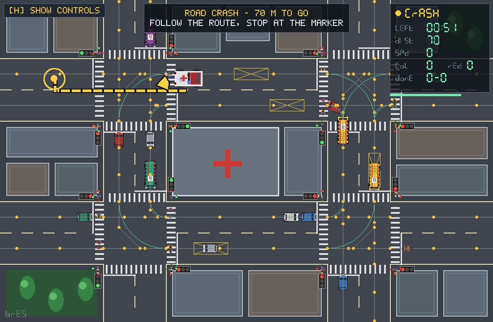 | 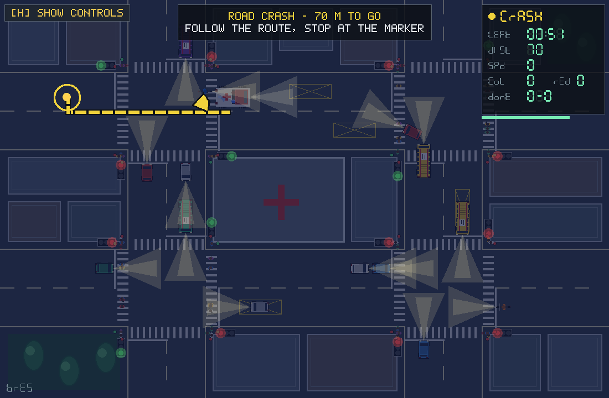 |

### A call from start to finish

Captured headless with the demo driver (`--screenshot <file> <seconds> !`):

| Driving to the call (OpenGL) | On scene: treatment ring | Transport to the hospital | Result screen |
|---|---|---|---|
| 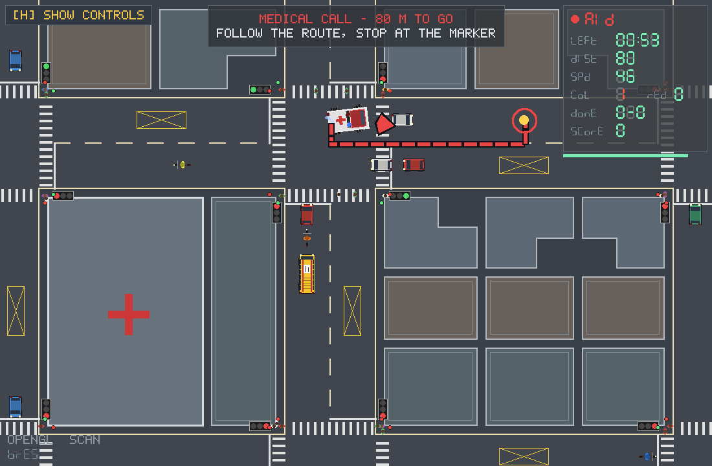 | 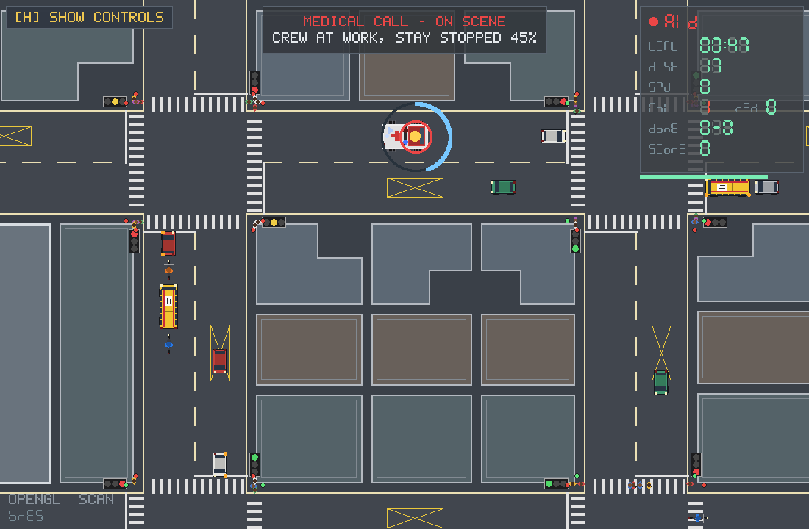 | 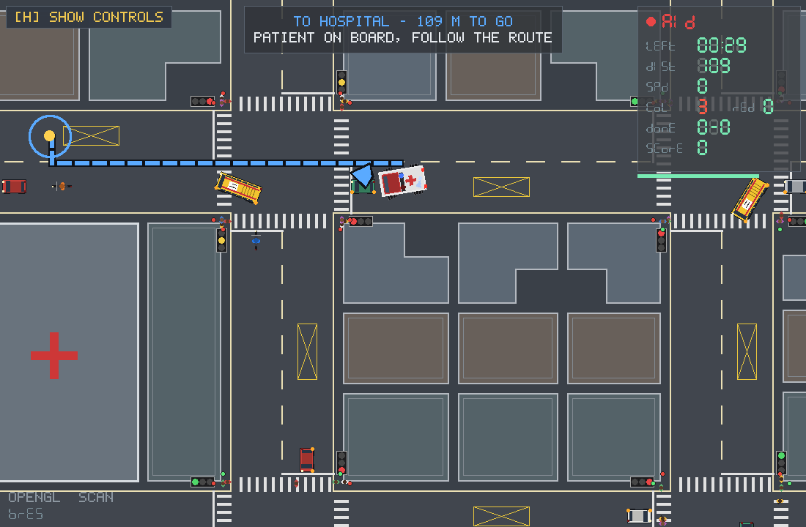 | 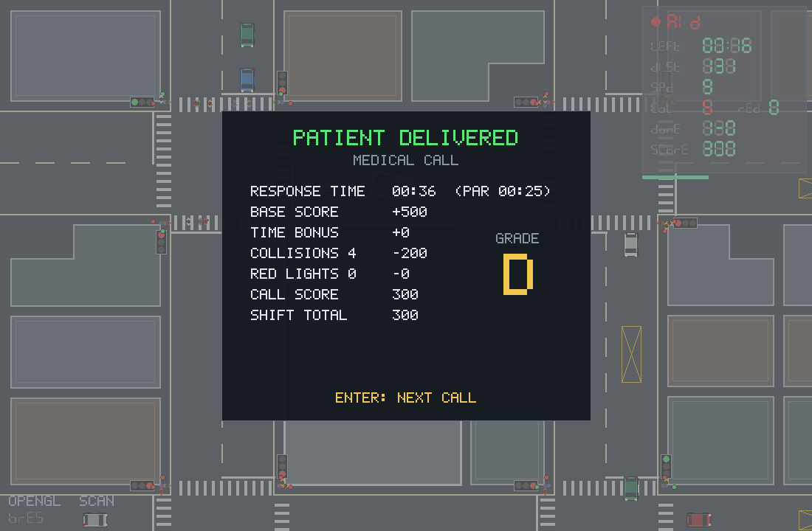 |

| Same frame, software renderer (O) | Dijkstra vs A* (V) | Ear clipping (F) | SAT and broad phase (G) |
|---|---|---|---|
| 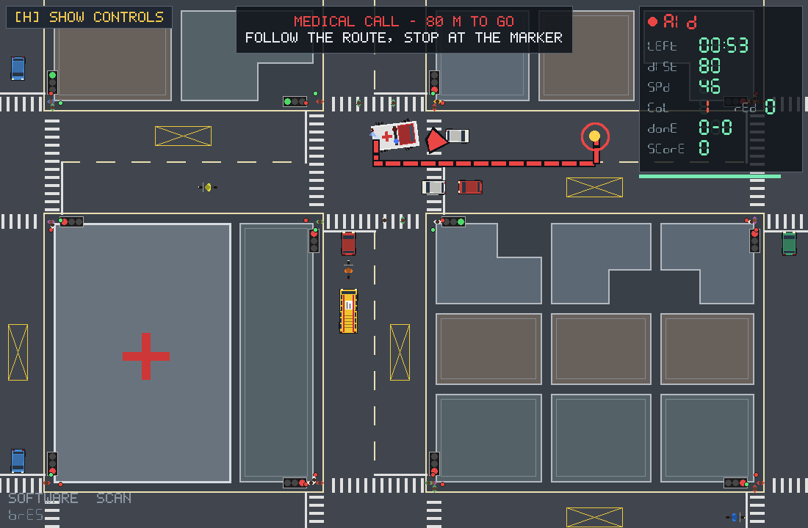 | 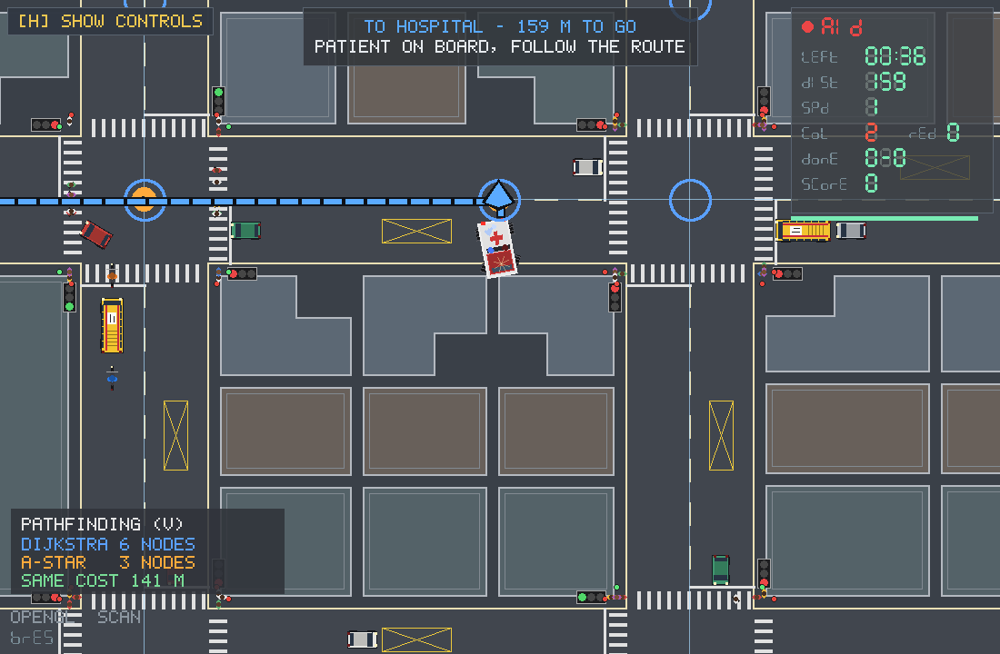 | 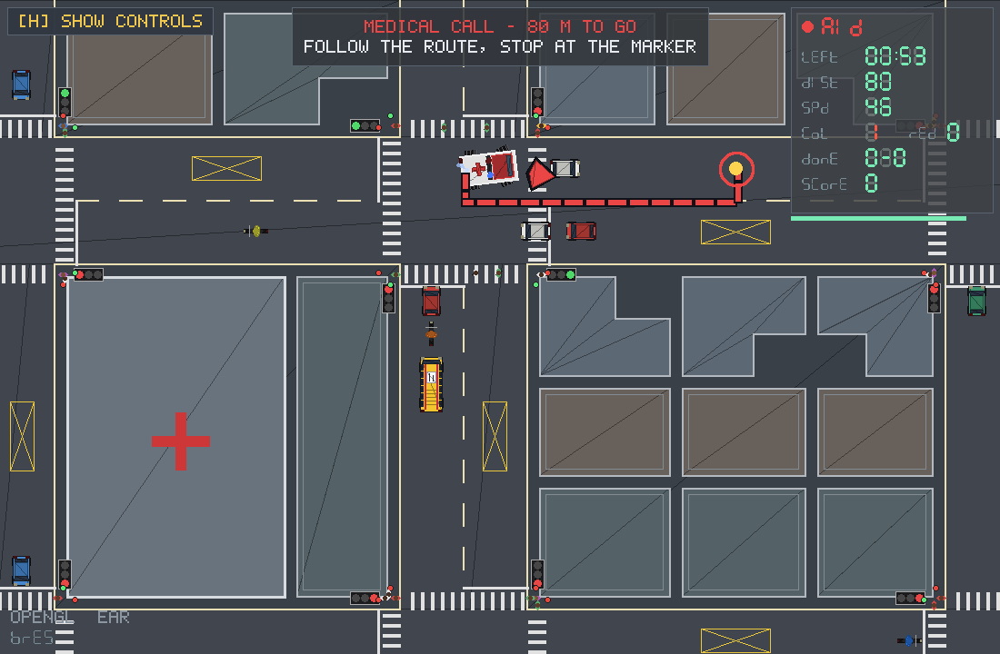 | 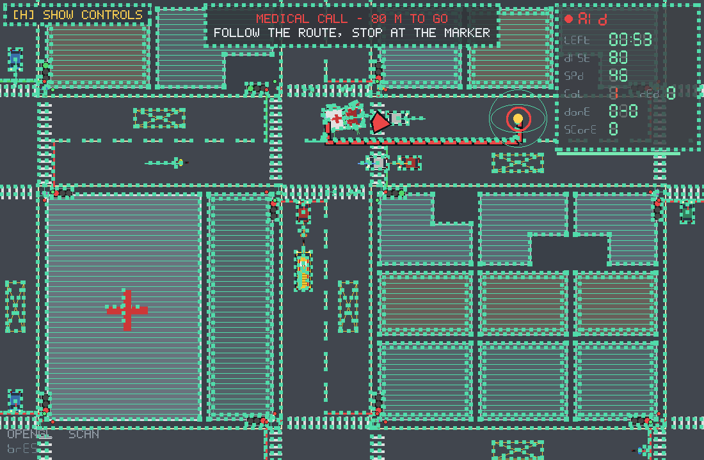 |

| Title menu | Camera clip window (C) |
|---|---|
| 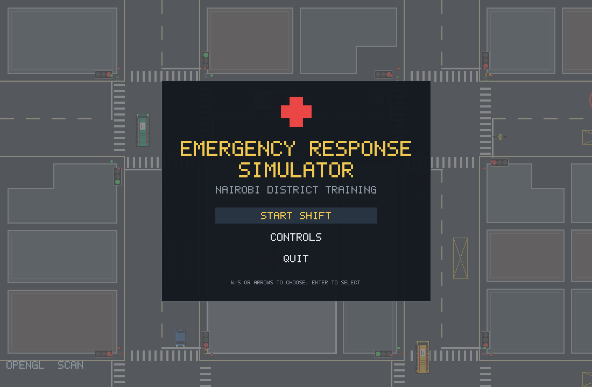 | 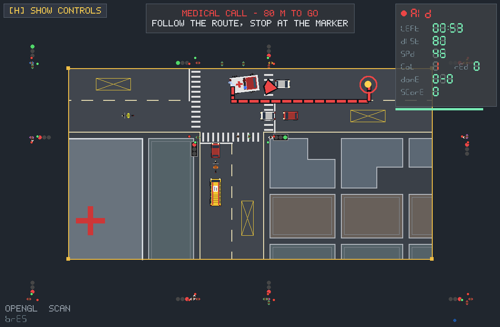 |

## Project Structure

```
src/
├── core/          Point, colours, Mat3, camera, letterbox, batched pixel/span output with point clipping (Raster.h)
├── lines/         DDA and Bresenham, LineRenderer
├── polygons/      Polygon class, transformations (via Mat3), ear-clipping triangulation
├── rasterization/ Scan-line fill, Cohen–Sutherland and Sutherland–Hodgman
├── shapes/        Midpoint circle and ellipse
├── curves/        Cubic Bézier, Catmull-Rom, arc-length spline paths
├── city/          Road network and road graph, signals, red-light camera, city, pedestrians, day/night
├── simulation/    Ambulance (scene graph), traffic, SAT collisions, missions, Dijkstra/A*, demo driver
├── render/        IRenderer, OpenGL (legacy) and software backends
├── ui/            Seven-segment and 5x7 pixel fonts, HUD, controls panel, objective banner, minimap, menus
├── Game.*         Fixed-timestep main loop
└── main.cpp       Entry point
tests/             Unit tests (run with ctest)
docs/screenshots/  Screenshots
DEMO.md            Five-minute demo script
```

## How to Compile and Run

Requirements: a C++17 compiler, CMake 3.16+, SFML 2.5 or 2.6 and OpenGL 1.x (legacy) headers and library.

OpenGL setup per OS:

- **Windows**: nothing extra; `opengl32` ships with Windows and the Visual Studio / MinGW SDKs.
- **Linux**: install the Mesa development package, e.g. `sudo apt install libgl1-mesa-dev` (plus `libsfml-dev`).
- **macOS**: OpenGL is part of the system frameworks (`-framework OpenGL`); CMake finds it automatically. Install SFML with `brew install sfml@2`.

```bash
mkdir build
cd build
cmake ..
cmake --build .
./EmergencyResponseSimulator
ctest            # run the unit tests
```

On Windows, the executable is built in `build/Debug/` or `build/Release/`, depending on the generator. The SFML DLLs must be next to the `.exe` or on the `PATH`. If CMake cannot find SFML, pass `-DSFML_DIR=<path-to-SFML>/lib/cmake/SFML`.

Screenshots can be produced without a window:

```bash
./EmergencyResponseSimulator --screenshot night.png 15 TT   # 15 s simulated, night mode
./EmergencyResponseSimulator --screenshot soft.png 15 O     # same scene, software renderer
./EmergencyResponseSimulator --screenshot call.png 26 !     # the demo driver follows the route
./EmergencyResponseSimulator --screenshot menu.png 3 @      # title menu
./EmergencyResponseSimulator --screenshot wide.png 3 "" 1600x700   # letterboxed into another window size
```

The demo driver (`src/simulation/DemoDriver.*`) produces the same inputs as the keyboard: pure pursuit on the lane beside the route, `v = sqrt(2·b·d)` to stop on the target, slower through bends, braking for anything in front, reversing onto a target it overshot and three-point turns where a U-turn does not fit. `tests/test_full_call.cpp` uses it to run whole calls (scene, treatment, hospital) through live traffic without a window.

### Controls

| Key | Action |
|---|---|
| W / ↑ | Accelerate |
| S / ↓ | Brake, then reverse |
| A / ← , D / → | Steer |
| Space | Handbrake |
| H (or click its title bar) | Show / minimise the controls panel (it folds away by itself when you first accelerate) |
| E | Siren on / off (traffic only makes way while it is on) |
| P | Pause / resume |
| R | Restart: ambulance, traffic and signals back to the start, counters cleared |
| T | Day → day/night cycle → night |
| L | Line drawing: Bresenham → DDA → graphics API (GL_LINES) |
| F | Polygon fill: scan-line → ear-clipped triangles → graphics API (GL_TRIANGLES) |
| O | Switch renderer: OpenGL ↔ software |
| G / B / C | Graphics, curve and clipping debug views |
| V | Dijkstra vs A* comparison overlay |
| M | Minimap on / off |
| F12 | Save a screenshot |
| A / D or ← / → (title menu) | Change the difficulty |
| Enter | Select in menus, continue after a call |
| Esc | Pause; again for the main menu (quits from the main menu) |

## Testing

`ctest` runs 21 test executables (plain asserts, no framework, no window):

| Area | Tests |
|---|---|
| Maths and algorithms | `mat3`, `ear_clipping`, `collision` (AABB and SAT), `pathfinding` (Dijkstra and A*), `letterbox`, `camera` (view, culling and clipping) |
| City and traffic | `traffic_signals`, `traffic_rules`, `traffic_system` (7-minute soak without overlaps, siren yielding, spawn area), `road_graph` (graph, city, labels), `congestion` |
| Driving and calls | `driving` (model, skid marks, siren), `route` (route planning, trimming, wrong turns), `mission` (call state machine), `scoring`, `high_scores` |
| Interface | `hud`, `help_panel` (panel and banner texts), `render_paths`, `minimap` (window-to-viewport, nothing drawn outside it) |
| Whole game | `full_call`: two complete calls (route, live traffic with the siren, treatment, hospital) driven by the demo driver |

## Features

- Calls of five kinds (medical, road crash, fire, cardiac arrest, maternity) as a state machine: drive there, treat on scene, take the patient to hospital, scored result with grade
- Live traffic on a 4 × 3 grid of signalised junctions: cars, matatus and motorcycles, pedestrians at zebra crossings, a red-light camera
- Siren yielding: traffic ahead pulls over, oncoming traffic slows, crossing traffic holds; congestion measured per road section and avoided by A*
- Wrong-route recalculation with a banner notice and a small penalty
- Hierarchical ambulance with steering wheels, light bar and beacon; driving model with handbrake and collision response
- Skid marks and a red/blue siren glow that follows the day/night cycle
- Camera that follows the ambulance, minimap (window-to-viewport transformation), road names, lane arrows, point and span clipping
- Two renderers (legacy OpenGL with a display list, and software) switchable at run time
- Title menu, pause, result and game-over screens; difficulty levels (traffic, time limits, score multiplier) and a saved high-score table
- Resizable, letterboxed window; pause on focus loss

| Night, siren glow | Congestion overlay (V) | Transport to hospital with the minimap |
|---|---|---|
| 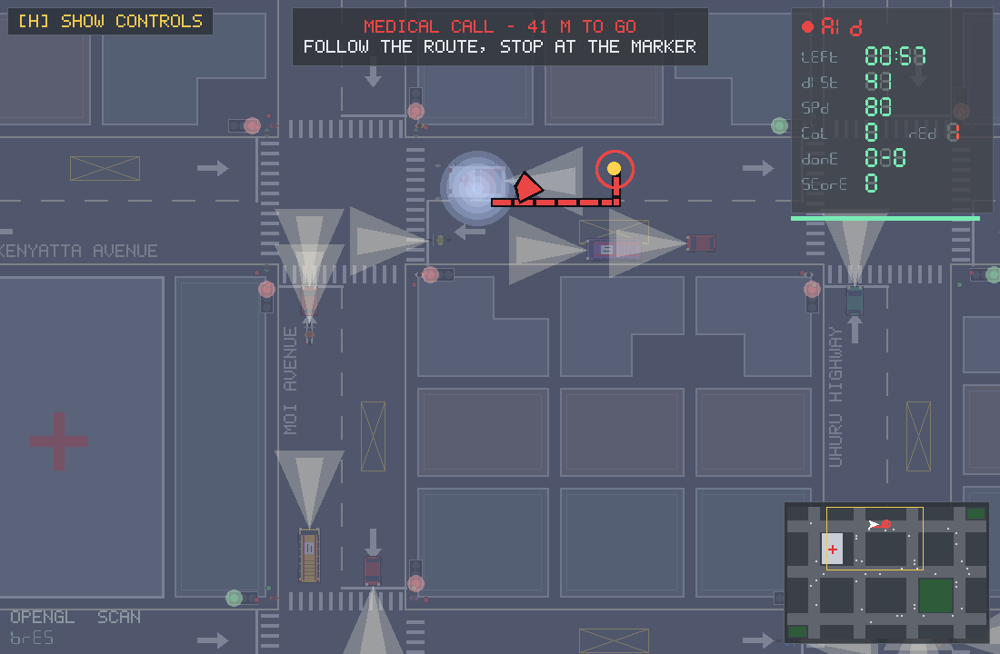 | 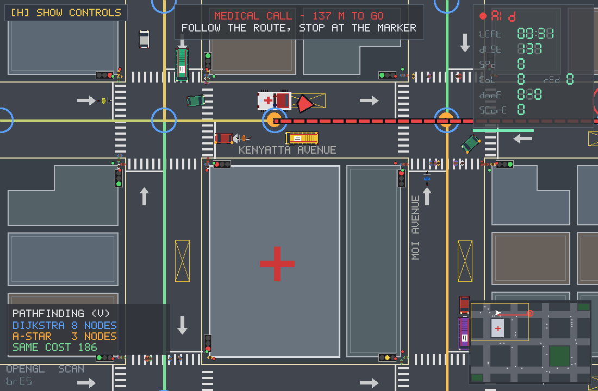 | 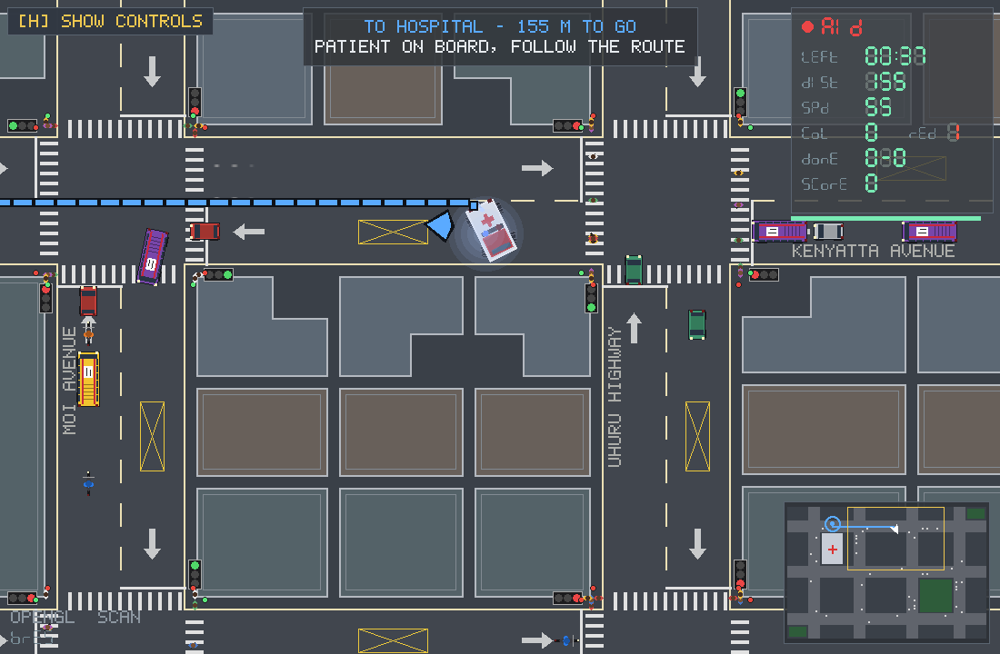 |

| Difficulty menu | Resized (letterboxed) window | Clipping frame (C), pixels clipped too |
|---|---|---|
| 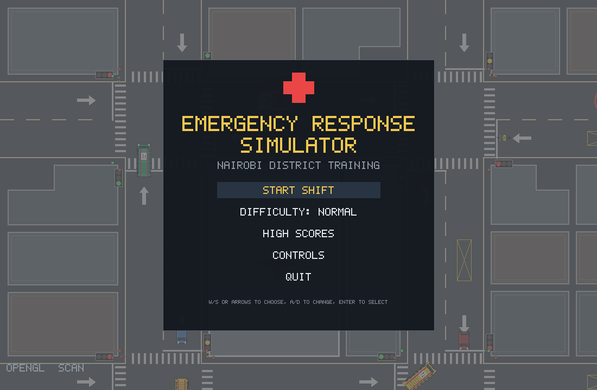 | 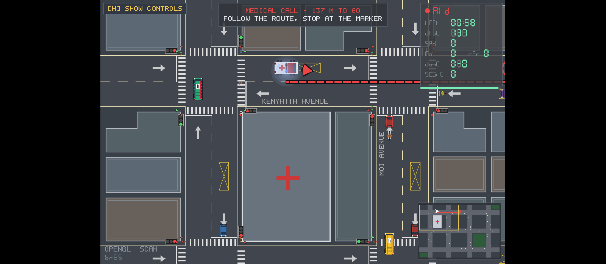 | 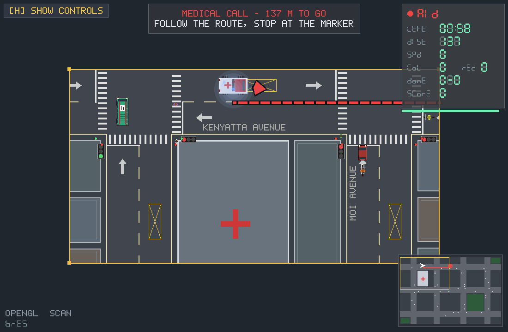 |

A five-minute demo script is in [DEMO.md](DEMO.md).

## Known Limitations and Issues

- Route guidance follows road centre lines; it accounts for queues (congestion) but not for the current signal state.
- The ambulance turning circle does not fit a U-turn between the kerbs; turning round needs a three-point turn.
- Built against SFML 2.x; SFML 3 changed its API and is not supported yet.
- No sound: the siren is visual only.
- The demo driver used for the headless captures and the end-to-end test is deliberately simple; it bumps into traffic more often than a person would.
- Legacy (fixed-function) OpenGL only; it is deprecated in modern core profiles but still supported by the compatibility profiles on Windows, Linux and macOS.
